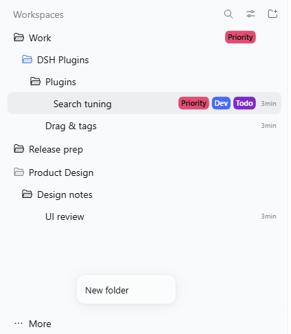

<div align="center">
  <h1>DSH-better-classifier</h1>
  <p>Organize your DSH projects and conversations with folders, colored tags, and tree-shaped search.</p>
  <p><a href="README_ZH.md"><strong>中文</strong></a> · English</p>
  <p>
    <a href="https://www.npmjs.com/package/dsh-better-classifier"></a>
    <a href="https://github.com/MakerFlyFly/DSH-better-classifier/actions/workflows/ci.yml"></a>
    <a href="LICENSE"></a>
    <a href="compatibility.json"></a>
  </p>
</div>

<p align="center">
  
</p>

## Highlights

- **Folder organization** — group projects in virtual folders, then organize conversations inside each project. Both levels support nested folders.
- **Colored tags** — label projects, folders, and conversations. Add, remove, and edit tags in one dialog; wider sidebars display more tags.
- **Tree-shaped search** — find names, tags, conversation IDs, and message content while keeping the surrounding folder structure.

## Quick start

**Requires stock DSH `0.2.2-rc.2` and Node.js `>=24.9.0`.** Version `0.2.1` has been validated on Windows x64. Other DSH versions and platforms have not been verified. See the [validation record](docs/validation.md).

Check your host version with `dsh --version`, then install:

```sh
dsh plugin --profile web add dsh-better-classifier@0.2.1
```

**Restart DSH and refresh its browser tab.** If DSH is not running, start the Web interface with `dsh web --no-open`. The install command targets the `web` profile; replace that name if you use a different profile.

The npm package is prebuilt. Installation needs no local build or DSH source patch.

## Everyday use

### 1. Create folders and organize the tree

Right-click the blank area below the list and choose **New folder** to create an outer folder. This also works with an empty list or no search results. To create a folder inside a project or another folder, use that row's context menu.

Drag one item at a time to move or reorder it, or use the row menu to rename it or choose a destination. Folders containing conversations stay within their project. Deleting a folder moves its direct children up one level and preserves the contents of nested folders.

For keyboard access, focus the blank list area and press the menu key or `Shift+F10`.

### 2. Add and edit tags

Open an item's tag editor from its row menu or by clicking its tags. Added tags appear at the top; available tags appear below. Click an available tag to add it, or use the × on an added tag to remove that association.

Click an added tag to edit its name or color, or use **Add tags** to create one. **Save** applies the changes together; **Cancel** discards the draft. Tags belong only to the items you explicitly label and do not inherit from parent folders.

Sidebar tags fit the available row width. `+N` appears only when tags overflow, with spacing kept before the time and action buttons.

### 3. Search, then explore

Use the existing sidebar search box to search names, direct tag names, conversation IDs, or message content. Up to **20 result entries** are shown; ancestor paths and contents you expand yourself do not count toward that limit.

Open a matching project or folder to browse its contents. A matching conversation appears with its ancestor path. Select a conversation to open it and reveal its location in the normal tree; clear the search to return to your classifications.

## Common questions and data

**Does moving an item change its files or working directory?**

No. Folders provide virtual classification; the actual files and working directories stay in place.

**Why are matching folders collapsed?**

Search first shows the outermost matching project or folder so its contents do not fill the results. Expand it to browse one level at a time, including children that did not match the query. Archive conditions still apply. When only a conversation matches, the necessary ancestor path opens to show it.

**What happens when I disable or uninstall the plugin?**

Disabling it from DSH's Plugins page restores the native list. To uninstall:

```sh
dsh plugin --profile web remove dsh-better-classifier
```

Classification data is retained for reinstallation. It is separate from conversation logs and model context, and uses the configured DSH storage backend: by default, `storages/better_classifier.json` under `DSH_HOME`. Expansion preferences stay in the browser. There is no cloud sync between independent DSH instances.

**Does content search store message text?**

Yes. The first content search enables DSH's shared local SQLite index at `storages/better_classifier_search.sqlite` under `DSH_HOME`. **It stores searchable message text and may index all persisted conversations.** Candidate IDs and access checks restrict the results, not the indexing scope. Disk usage grows with the indexed history.

Disabling or uninstalling the plugin leaves this index file in place. Deleting a conversation does not guarantee immediate physical erasure of its text from SQLite. Memory-only indexing, disabling content indexing, and clearing the derived index are described below.

## Advanced options

<details>
<summary><strong>Install from a release archive or source</strong></summary>

Download `dsh-better-classifier-0.2.1.tgz` from [GitHub Releases](https://github.com/MakerFlyFly/DSH-better-classifier/releases/tag/v0.2.1) and verify its SHA-256 against the accompanying checksum file. Replace the package name in the install command with the local archive path.

The Git repository contains source code. Follow the development build below before installing from a local checkout. Published packages and catalogue applications are tracked in [distribution status](docs/distribution.md).

</details>

<details>
<summary><strong>Upgrade from the patched 0.1.x releases</strong></summary>

Back up your data, then install `0.2.1` into stock DSH `0.2.2-rc.2`, using the same DSH data directory and profile. Version `0.1.x` required a custom host patch; `0.2.x` does not. Do not reverse-apply an old patch over a source checkout containing unrelated edits.

Versions `0.1.x` and `0.2.x` use the same version-1 `better_classifier` storage format. Folders, tags, placements, ordering, and revisions need no migration. The browser expansion key is unchanged; old tag-visibility and standalone-filter preferences remain ignored.

An existing trial can remain alongside an isolated development instance; use separate data directories and ports.

</details>

<details>
<summary><strong>Configure or clear the content-search index</strong></summary>

Configuration is applied in this order: plugin bundle → profile patch → `DSH_HOME` patch → command-line overlay. Later user configuration takes precedence.

For a memory-only index, add this to the profile's `cordis.patch.yml` or an existing user overlay:

```yaml
- id: session-query-sqlite
  config:
    path: ':memory:'
    openAt: first-search
```

Set `openAt: never` to disable content indexing; name and tag search remain available. Disabling or uninstalling BetterClassifier removes its configuration layer, but keeps the derived index file.

To clear the default disk index:

1. Close every DSH process using that `DSH_HOME`.
2. In `storages`, manually remove only `better_classifier_search.sqlite` and its `-wal` / `-shm` sidecars. A later search can rebuild the index.

Keep `better_classifier.json` and conversation logs. Do not delete a custom database path shared by other configurations.

</details>

<details>
<summary><strong>Handle save failures, search errors, or sidebar conflicts</strong></summary>

- **Concurrent edits:** saves are atomic and check the server revision. A conflicting draft is refused; reopen the editor before retrying. Write failures retain your draft. Unknown or temporarily unloaded project/conversation IDs are not automatically removed from classification storage.
- **Content-search errors:** name matches remain visible, with a Retry action for content search.
- **Unsupported sidebar extensions:** the native sidebar returns and new classification actions are hidden. Open drafts are retained with Save disabled until the adapter recovers. Removing the conflicting nested contribution restores classification automatically.

</details>

## Development

<details>
<summary><strong>Build, test, and run an isolated demo</strong></summary>

Dependencies come from npm; the Loader regression also needs the system `tar` utility. A local DSH source checkout, symlinks, or machine-specific paths are not required.

```sh
corepack pnpm install --frozen-lockfile --ignore-scripts
pnpm build
pnpm typecheck
pnpm package
pnpm test
pnpm dev --fixture
```

`pnpm verify` runs build → typecheck → package → test. Typechecking needs the generated Remote declarations, and the Loader test needs the current tarball. Host and Client tests are typechecked separately alongside production source.

The demo uses `.dev/review-0.2.1/home` and port `3085`; pass `--port=3087` to use another port. Startup prints a local authentication URL. `--fixture` seeds demonstration projects and conversations and exercises storage/search without calling a model.

For browser lifecycle checks, stop after seeding and run `pnpm dev --installed --port=3087` without `--fixture`. Fixture modules have a separate private package boundary so DSH cannot discover the source Client through them. Automated tests use separate data directories and the published stock DSH CLI.

The tarball and source ZIP are written to `dist/`. Source archives respect root and nested ignore rules and can be built without `.git`. Local profiles, sessions, credentials, caches, logs, and work records are excluded. Public screenshots use demonstration data.

See the [validation record](docs/validation.md) and [release process](docs/release.md).

</details>

<details>
<summary><strong>How the DSH integration works</strong></summary>

The adapter shadows the public `sidebar.workspaces` registration and reuses native action/state shares. Picker, row-action, and decoration contributions are mirrored into plugin-owned child slots and released with their owning registration. These interfaces can change, so compatibility is pinned to the tested host version.

`betterClassifier.searchContent` handles candidate-filtered content search, applying authorization and filters before limiting results. Remote metadata is generated in a temporary build workspace without modifying installed DSH or generator files.

</details>

## Feedback and license

[Report an issue](https://github.com/MakerFlyFly/DSH-better-classifier/issues) · [Changelog](CHANGELOG.md) · [Validation](docs/validation.md) · [Distribution status](docs/distribution.md)

[MIT](LICENSE). The UI adapter derives from MIT-licensed DeepSeek Harness; see [third-party notices](THIRD_PARTY_NOTICES.md).
