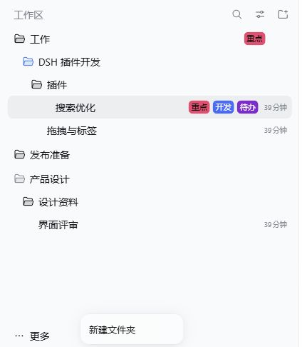

<div align="center">
  <h1>DSH-better-classifier</h1>
  <p>用文件夹分类、彩色标签和树形搜索，整理 DSH 项目与会话。</p>
  <p><strong>中文</strong> · <a href="README.md">English</a></p>
  <p>
    <a href="https://www.npmjs.com/package/dsh-better-classifier"></a>
    <a href="https://github.com/MakerFlyFly/DSH-better-classifier/actions/workflows/ci.yml"></a>
    <a href="LICENSE"></a>
    <a href="compatibility.json"></a>
  </p>
</div>

<p align="center">
  
</p>

## 功能概览

- **文件夹分类**：外层文件夹整理项目，项目内文件夹整理会话，两类文件夹都支持嵌套。
- **彩色标签**：给项目、文件夹和会话打标签，在同一弹窗里添加、移除和编辑。拉宽侧栏，就能显示更多标签。
- **树形搜索**：统一搜索名称、标签、会话 ID 和正文，结果保留目录层级，方便继续浏览。


## 快速安装

**要求原版 DSH `0.2.2-rc.2` 和 Node.js `>=24.9.0`。** 插件 `0.2.1` 已在 Windows x64 验证，其他 DSH 版本和平台尚未验证。详见[验证记录](docs/validation.md)。

先用 `dsh --version` 确认宿主版本，再安装：

```powershell
dsh plugin --profile web add dsh-better-classifier@0.2.1
```

**安装后重启 DSH，并刷新浏览器页面。** 如果 DSH 尚未运行，可用 `dsh web --no-open` 启动 Web 界面。安装命令使用 `web` profile；使用其他 profile 时，请替换对应名称。

npm 包已包含构建产物，无需本地构建或修改 DSH 源码。

## 基本用法

### 1. 新建文件夹，整理目录树

在列表下方空白处右键，选择**新建文件夹**，即可创建最外层文件夹；空列表和搜索无结果时也可操作。要在项目或文件夹内部新建，请使用对应行的右键菜单。

逐项拖拽即可移动或调整顺序，也可以通过行菜单重命名或选择移动位置。会话文件夹的移动限于同一项目。删除文件夹后，其直接子项移到上一层，子文件夹内部结构保留。

使用键盘时，先让列表空白区域获得焦点，再按菜单键或 `Shift+F10`。

### 2. 添加和编辑标签

通过行菜单或点击行上的标签打开编辑器。上方显示已添加标签，下方显示可添加标签；点击下方气泡即可添加，点击上方气泡的 × 移除当前关联。

点击已添加的气泡可修改名称和颜色，点击**添加标签**可新建。最后点**保存**统一提交，或点**取消**放弃草稿。标签只属于明确打标的对象，不从上级文件夹继承。

侧栏会按可用宽度展示标签，仅放不下时显示 `+N`，并与时间和操作按钮保持间距。

### 3. 搜索定位，展开浏览

在原生侧栏搜索框输入名称、直接标签名、会话 ID 或正文内容。最多显示 **20 个结果入口**，祖先路径和主动展开的内容不占限额。

点击命中的项目或文件夹可浏览内部内容；命中的会话会带上祖先路径。选择会话后，插件打开聊天并定位到常规分类树中的位置；清除搜索即可返回完整分类视图。

## 常见问题与数据说明

**移动分类会改变文件位置或工作目录吗？**

不会。文件夹用于虚拟分类，真实文件和工作目录保持原样。

**为什么搜索到的文件夹默认折叠？**

搜索先显示最外层命中的项目或文件夹，避免内部内容占满结果。展开后可逐层浏览，包括未命中搜索的子项，但仍遵循归档条件。只有会话命中时，会展开必要的祖先路径，直接显示该会话。

**停用或卸载后会怎样？**

在 DSH 插件页停用后，会恢复原生列表。卸载命令为：

```powershell
dsh plugin --profile web remove dsh-better-classifier
```

分类数据会保留，重新安装可继续使用。它独立于会话日志，不进入模型上下文，保存在配置的 DSH 存储后端中，默认位置是 `DSH_HOME` 下的 `storages/better_classifier.json`。展开偏好保存在浏览器中，不提供独立 DSH 实例间的云同步。

**正文搜索会保存消息内容吗？**

会。首次正文搜索会启用 DSH 共享的本地 SQLite 索引，默认位于 `DSH_HOME` 下的 `storages/better_classifier_search.sqlite`。**索引保存可检索的消息正文，可能覆盖全部持久化会话。** 候选范围和访问权限限制查询结果，不限制建库范围；磁盘占用会随历史内容增加。

停用或卸载插件后，索引文件仍会保留。删除会话也不代表正文立即从 SQLite 中物理清除。仅使用内存索引、关闭正文索引或清空派生索引的方法见下方。

## 进阶选项

<details>
<summary><strong>从安装包或源码安装</strong></summary>

从 [GitHub Releases](https://github.com/MakerFlyFly/DSH-better-classifier/releases/tag/v0.2.1) 下载 `dsh-better-classifier-0.2.1.tgz`，使用配套校验和文件核对 SHA-256，然后将安装命令中的包名替换为本地压缩包路径。

Git 仓库提供源码，从本地源码安装前需完成下方开发构建。已发布的安装包及市场申请进展见[分发状态](docs/distribution.md)。

</details>

<details>
<summary><strong>从依赖补丁的 0.1.x 升级</strong></summary>

先备份数据，再使用相同的 DSH 数据目录和 profile，将 `0.2.1` 安装到原版 DSH `0.2.2-rc.2`。`0.1.x` 依赖自定义宿主补丁，`0.2.x` 已无需该补丁。不要在包含其他改动的源码工作区盲目反向应用旧补丁。

`0.1.x` 与 `0.2.x` 沿用 `better_classifier` 第 1 版存储格式，文件夹、标签、归属、顺序和修订号无需迁移。浏览器展开偏好的键保持不变；旧的标签隐藏和独立筛选偏好继续忽略。

旧试用环境可与独立开发环境并存，使用不同的数据目录和端口即可。

</details>

<details>
<summary><strong>配置或清理正文搜索索引</strong></summary>

配置依次应用：插件 bundle → profile 补丁 → `DSH_HOME` 补丁 → 命令行覆盖。后面的用户配置优先。

若希望索引只保存在内存，可在所用 profile 的 `cordis.patch.yml` 或现有用户覆盖文件中加入：

```yaml
- id: session-query-sqlite
  config:
    path: ':memory:'
    openAt: first-search
```

设置 `openAt: never` 可关闭正文索引，名称和标签搜索仍然可用。停用或卸载 BetterClassifier 会移除其配置层，但保留派生索引文件。

清空默认磁盘索引的方法：

1. 关闭所有使用该 `DSH_HOME` 的 DSH 进程。
2. 在 `storages` 中，仅手动删除 `better_classifier_search.sqlite` 及对应的 `-wal` / `-shm` 文件。后续搜索可重新建立索引。

保留分类数据 `better_classifier.json` 和会话日志。不要删除其他配置共用的自定义数据库路径。

</details>

<details>
<summary><strong>处理保存失败、搜索错误或侧栏冲突</strong></summary>

- **并发编辑**：保存会核对服务端修订号并原子提交，冲突时拒绝覆盖，需要重新打开编辑器后重试。写入失败会保留草稿。暂未加载或未知的项目、会话 ID 不会被自动从分类数据中清理。
- **正文搜索失败**：保留名称匹配结果，并提供正文搜索重试入口。
- **遇到不支持的侧栏扩展**：恢复原生侧栏，隐藏新的分类入口。已打开的草稿保留，适配恢复前禁用保存；移除冲突的嵌套扩展后自动恢复分类视图。

</details>

## 开发

<details>
<summary><strong>构建、测试与独立演示环境</strong></summary>

依赖从 npm 安装，Loader 回归还需系统提供 `tar` 工具。不依赖本机 DSH 源码、目录链接或固定机器路径。

```powershell
corepack pnpm install --frozen-lockfile --ignore-scripts
pnpm build
pnpm typecheck
pnpm package
pnpm test
pnpm dev --fixture
```

`pnpm verify` 按构建 → 类型检查 → 打包 → 测试执行。类型检查需要构建生成的 Remote 声明，Loader 测试需要当前版本安装包；Host 和 Client 测试分别接受类型检查，与生产源码一并验证。

演示环境使用 `.dev/review-0.2.1/home`，默认端口为 `3085`，可用 `--port=3087` 指定其他端口。启动时输出本地认证地址。`--fixture` 创建演示项目和会话，验证存储与搜索，不调用模型。

进行浏览器启停检查时，准备数据后先停止进程，再运行 `pnpm dev --installed --port=3087`，不加 `--fixture`。夹具具有独立的私有包边界，避免 DSH 从夹具发现源码 Client。自动化测试使用独立数据目录和正式发布的原版 DSH CLI。

安装包与源码 ZIP 输出到 `dist/`。源码打包遵守根目录及嵌套忽略规则，解压后没有 `.git` 也可构建。本地 profile、会话、凭据、缓存、日志和开发记录不进入安装包或源码包；公开截图使用演示数据。

详见[验证记录](docs/validation.md)与[发布流程](docs/release.md)。

</details>

<details>
<summary><strong>DSH 接入方式</strong></summary>

适配层替换公开的 `sidebar.workspaces` 注册项，复用原生操作回调和状态。目录选择器、行操作及装饰贡献映射到插件自己的子插槽，并随原注册释放。接口仍在演进，因此兼容范围固定为已验证的宿主版本。

`betterClassifier.searchContent` 负责带候选范围的正文搜索，权限和筛选条件在结果截取前生效。Remote 元数据在临时构建目录生成，不修改已安装的 DSH 或生成器文件。

</details>

## 反馈与许可证

[反馈问题](https://github.com/MakerFlyFly/DSH-better-classifier/issues) · [更新日志](CHANGELOG.md) · [验证记录](docs/validation.md) · [分发状态](docs/distribution.md)

[MIT](LICENSE)。界面适配代码基于 MIT 许可的 DeepSeek Harness，见[第三方许可说明](THIRD_PARTY_NOTICES.md)。
