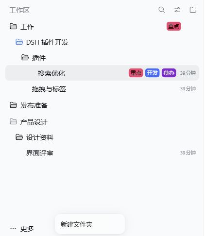

# BetterClassifier

Organize projects and conversations into a clear folder tree, mark them with colored tags, and find them through one search field.

- Right-click empty list space to create a folder. Project and folder menus create nested folders.
- Move projects, folders, and conversations with drag and drop or their row menus.
- Add and remove tags on one page. Click a chip to edit its name or color; save commits the draft together.
- Search names, direct tags, conversation IDs, and message content. Matching containers start collapsed and can be browsed one level at a time.
- Wider sidebars show more tags. Native pinning, archiving, status indicators, and menus remain available.

## Compatibility

Version 0.2.0 is validated on Windows x64 with stock DSH 0.2.2-rc.2, without source patches. Restart DSH and refresh the browser after installing.

## Data

Classification never moves real working directories. Folders, tags, and manual order belong to the DSH instance; expansion belongs to the browser. Tags are direct, without inheritance. Disabling or removing the plugin restores the native list and retains classification data for reinstallation.
