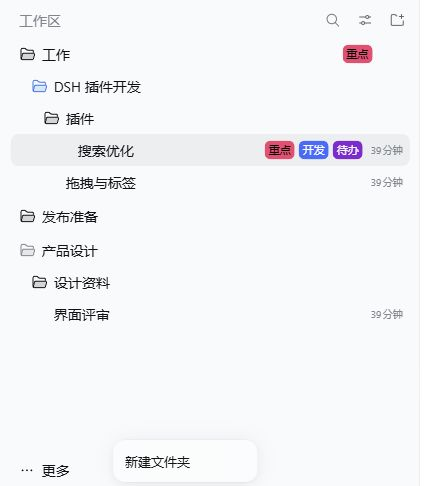

# BetterClassifier

将项目和会话整理成清楚的目录树，使用彩色标签标记重要内容，再通过搜索定位。

- 在会话列表空白处右键新建文件夹；项目和文件夹菜单支持在内部新建。
- 拖动项目、文件夹或会话调整位置，也可通过行菜单移动。
- 在同一页添加和移除标签，点击气泡修改名称或颜色；保存后统一生效。
- 搜索名称、标签、会话 ID 和正文。命中的文件夹默认折叠，展开后可逐层浏览。
- 侧栏拉宽时自动显示更多标签，保留原生置顶、归档和运行状态。

## 兼容性

0.2.2 支持 Windows x64、原版 DSH 0.2.2-rc.2，无需源码补丁。首次安装后重启 DSH 并刷新页面。

## 数据

分类不会改变真实工作目录。分类、标签和手动顺序保存在当前 DSH 实例；展开状态保存在浏览器。标签不向下继承。停用或卸载插件会恢复原生列表，分类数据保留供重新安装后使用。
